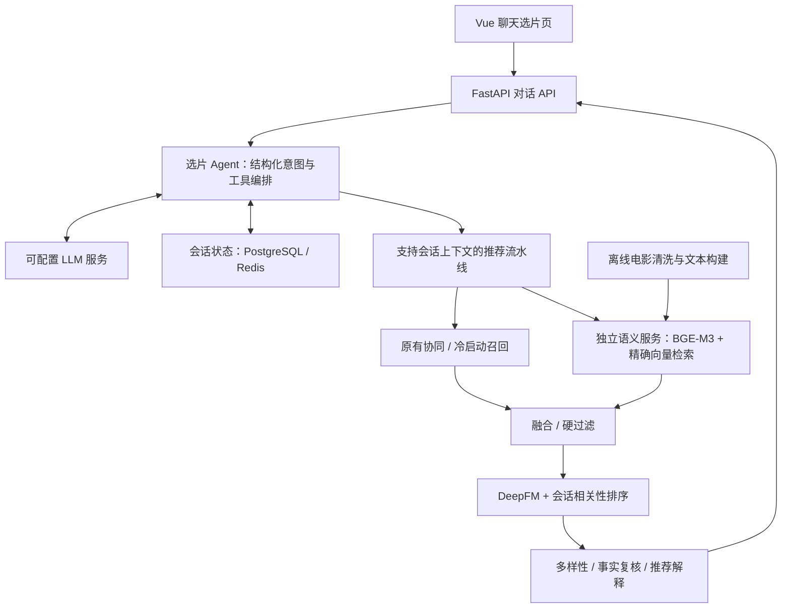

# CineWeave · 影织

**多轮选片 Agent × 语义召回 × 个性化推荐**

CineWeave 面向自然语言选片：理解用户本次需求，检索电影内容，结合长期偏好排序，并根据后续对话修改结果。项目计划基于 Datawhale FunRec 的电影推荐链路扩展。

> **当前状态：技术设计与仓库骨架，尚未实现应用代码。** 本仓库用于保存设计文档和后续代码。文档中的服务、接口、测试集、性能数字均为计划或验收目标；现有 FunRec 的能力不等于本仓库已经实现的能力。

## 计划支持的交互

> 用户：推荐几部关于虚拟现实的科幻片，两个小时以内，不要恐怖片。
>
> 用户：这些太严肃了，轻松一点。
>
> 用户：第三部看过了，换一部，其他条件保留。

系统维护会话条件，复用已有协同推荐能力，新增电影内容语义召回与会话排序。电影 ID、片长、年份等事实由业务数据确定。

## V1 架构



原五服务（前端、后端、PostgreSQL、Redis、Elasticsearch）增加一个语义服务。V1 使用已有电影简介构建向量，不涉及 Semantic ID 生成式召回或推荐模型在线训练。

## 文档导航

| 文档 | 内容 |
| --- | --- |
| [V1 技术架构](docs/agent-v1/architecture.md) | 范围、组件、离线索引、Agent、候选与排序、故障路径 |
| [接口与状态契约](docs/agent-v1/contracts.md) | API、会话修改、候选字段、存储、追踪 |
| [目录与改动清单](docs/agent-v1/project-structure.md) | 后续代码目录；相对 FunRec 的新增、修改、复用模块 |
| [评估与验收](docs/agent-v1/acceptance.md) | 数据、检索、对话、消融、回归、故障、性能标准 |
| [实施里程碑](docs/agent-v1/implementation-plan.md) | 阶段顺序、交付物、完成条件 |
| [来源与数据说明](docs/provenance.md) | 上游项目、数据边界、已检查情况、引用与后续许可要求 |

## 仓库布局

```text
cineweave-agent/
├── backend/             # 后续 FastAPI / Agent / 推荐业务代码
├── semantic_service/    # 后续独立嵌入模型服务与离线索引构建
├── frontend/            # 后续 Vue 界面
├── evaluation/          # 后续测试数据、实验配置与报告
└── docs/                # 当前已提交的技术设计
```

上述代码目录目前只有占位文件。当前不存在可运行服务、部署命令、已通过的业务测试或算法提升结果。

## 开发约定

- 固定模型、索引、模板和实验配置版本；指标附带数据与协议。
- 用户身份由后端登录态确定；会话状态按用户与会话隔离。
- 当前请求的意图与权重通过参数传递，避免修改共享单例状态。
- 硬条件由结构化字段执行；LLM 不创造电影 ID 或补全未知事实。
- 凭据、`.env`、原始数据、模型权重、向量产物和用户日志不提交 Git。
- 后续引入上游源码时保留原许可、版权和来源说明。

设计版本：V1 draft · 2026-10-19。
