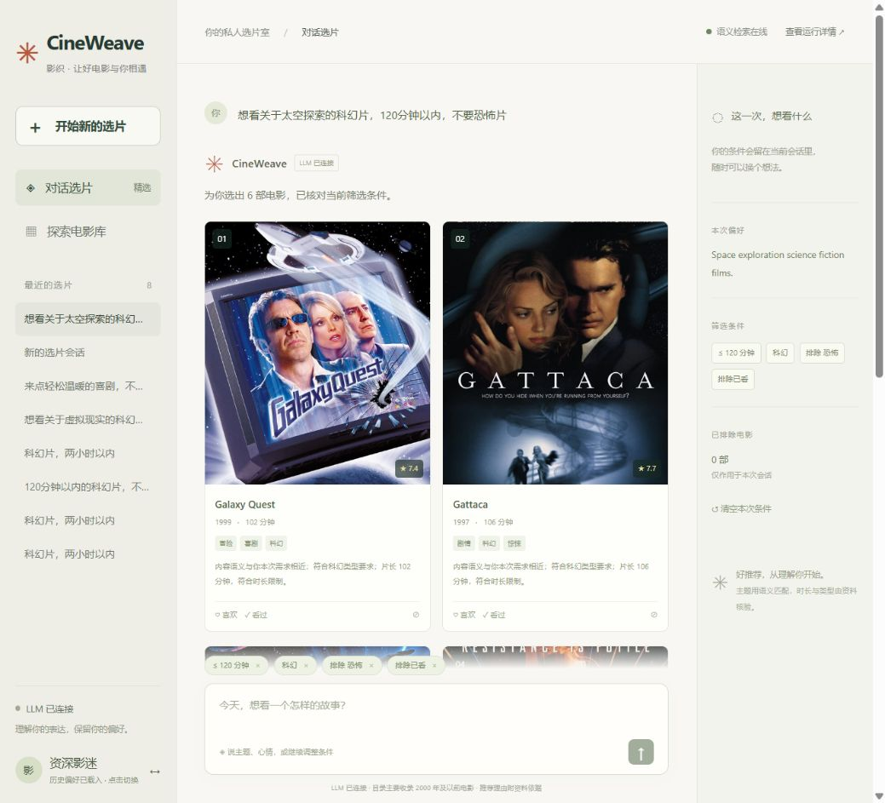
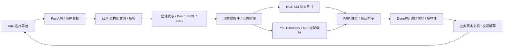

# CineWeave · 影织

**多轮电影选片 Agent：LLM 意图解析 × BGE-M3 语义召回 × 个性化推荐**

[](https://github.com/hershey1008/cineweave-agent/actions/workflows/unit-tests.yml)
[](LICENSE)

用自然语言提出选片需求，继续修改条件、替换电影、查看推荐依据。基于 Datawhale FunRec 扩展，复用已有推荐模型，新增会话 Agent、真实语义检索与工程验证。

**[观看／下载约 2 分钟演示](https://github.com/hershey1008/cineweave-agent/releases/tag/v0.1.0-demo)** · **[复现指南](docs/REPRODUCE.md)** · **[新增工作与来源](docs/CONTRIBUTIONS.md)** · **[实测记录](docs/LOCAL_VALIDATION.md)**

[](https://github.com/hershey1008/cineweave-agent/releases/tag/v0.1.0-demo)

> 视频由真实 LLM 界面截图剪辑而成，配中文旁白和字幕，省略请求等待；不是连续录屏。它不代表线上部署、准确率实验或稳定性压测。仓库目前提供本地应用，未提供公共交互服务。

## 一次完整对话

| 用户输入 | 系统行为 |
| --- | --- |
| 想看关于太空探索的科幻片，120分钟以内，不要恐怖片 | 解析主题、类型和片长；用结构化字段执行硬过滤 |
| 轻松一点，其他要求不变 | 修改氛围偏好，保留原筛选条件 |
| 第三部看过了，换一部 | 根据上一轮展示顺序解析指代，排除对应电影 |
| 时长不限了 | 仅清除片长上限 |
| 为什么推荐第一部？ | 查询上轮对应电影，提供资料与事实字段依据 |



## 实现方式



- **Agent 编排**：LLM 只输出受限意图；服务端校验并调用推荐工具，不让模型编造电影 ID、SQL 或事实。
- **语义召回**：独立 PyTorch 服务，固定 BGE-M3 revision、1024 维向量、精确检索与索引校验；本地语义目录 3532 部。
- **会话一致性**：未提及条件保留，支持清除与重置；消息幂等、拥有者校验、版本 CAS、失败不保存修改。
- **可观测与降级**：暴露通道、候选数、索引版本、阶段耗时和降级标记；区分 LLM 超时、鉴权、限流、协议错误。

当前采用“LLM 解析与工具编排 + 语义检索 + 推荐排序”。解释是事实模板；没有实现 Semantic ID 自回归召回，也没有训练新的生成式推荐模型。

## 复用与新增

| 范围 | 内容 |
| --- | --- |
| 复用、适配 FunRec | 原业务与认证、浏览界面、离线特征训练、YouTubeDNN / I2I / 类型偏好召回、DeepFM 与冷启动能力 |
| CineWeave 新增 | Agent 协议、多轮状态、语义清洗与索引服务、上下文融合排序、事实解释、聊天界面、反馈事件与测试工具 |
| 工程修正 | 序列时间方向、年份特征、ES 字段匹配、电影类型隔离、模型降级来源、跨层超时预算 |

详情见 [CONTRIBUTIONS.md](docs/CONTRIBUTIONS.md)。本地演示使用已有预训练推荐产物，不把它们表述为本次重新训练成果。

## 已验证结果

| 检查 | 实测 | 口径 |
| --- | --- | --- |
| 单元测试 | 96 项通过 | 状态、过滤、融合、索引校验、LLM 错误与跨层超时 |
| 在线接口 | 27 / 27 | 本地规则解析 + 真实语义、协同与 DeepFM |
| 多轮功能 | 40 组 / 120 轮通过 | 规则模式 fixture，不是人类满意度评估 |
| 真实 LLM 联调 | 5 / 5 轮通过 | 小规模功能回归，不能推断整体成功率 |
| 本机性能 | 200 / 200 成功，P95 603 ms | 规则模式、5 并发、10 条混合查询预热；不含外部 LLM 延迟 |

[公开摘要](docs/evidence/verification-summary.json) · [详细验收与限制](docs/LOCAL_VALIDATION.md)

120 条检索查询仍是待审核草案，没有人工相关性标注，不报告 nDCG / CTR / 留存提升。数据类型过滤也不等于完整的电影实体匹配审计。

## 快速检查源码

无需 API、模型或数据库即可运行单元测试：

```bash
git clone https://github.com/hershey1008/cineweave-agent.git
cd cineweave-agent
python -m pip install -r requirements-test.txt
python -m pytest -q
```

完整应用需要 Python 3.11 / Docker Compose、外部数据和推荐产物、BGE-M3 与语义索引。前端采用 Vue / Vite，构建需要兼容的 Node.js。未配置 API 时明确进入规则模式。

**首次克隆请按 [跨机器复现指南](docs/REPRODUCE.md) 准备外部产物，再按 [运行文档](docs/RUN_LOCAL.md) 启动。** 本仓库不包含作者电脑上的 `.env`、数据和模型，不宣称免配置的一键启动。

已有初始化环境：`docker compose up -d`；停止并保留数据：`docker compose stop`。本地页面 `http://localhost:13000`。

## 目录与文档

```text
backend/           FastAPI、Agent、离线/在线推荐、模型定义与测试
semantic_service/  BGE-M3 服务、内容清洗、版本化索引与测试
frontend/          Vue 多轮选片、事实弹窗、电影浏览
evaluation/        输入草案、功能 fixture、离线/在线验证入口
scripts/           环境检查、模型下载、索引固定、启停
docs/              架构、契约、来源、验收与演示材料
```

[架构](docs/agent-v1/architecture.md) · [接口与状态](docs/agent-v1/contracts.md) · [目录改动](docs/agent-v1/project-structure.md) · [来源](docs/provenance.md) · [演示制作说明](docs/media/README.md)

## 来源与许可

基于 [Datawhale FunRec](https://github.com/datawhalechina/fun-rec) 改造，按上游声明保留 CC BY-NC-SA 4.0 署名与相同许可要求。见 [LICENSE](LICENSE) 和 [第三方说明](THIRD_PARTY_NOTICES.md)。

MovieLens、扩充简介、电影海报、BGE-M3 与依赖各自保留其许可条件；本仓库不为这些第三方资产重新授予许可，不打包原始数据和模型权重。MovieLens 数据准备请遵循 [官方条款](https://files.grouplens.org/datasets/movielens/ml-1m-README.txt)。
