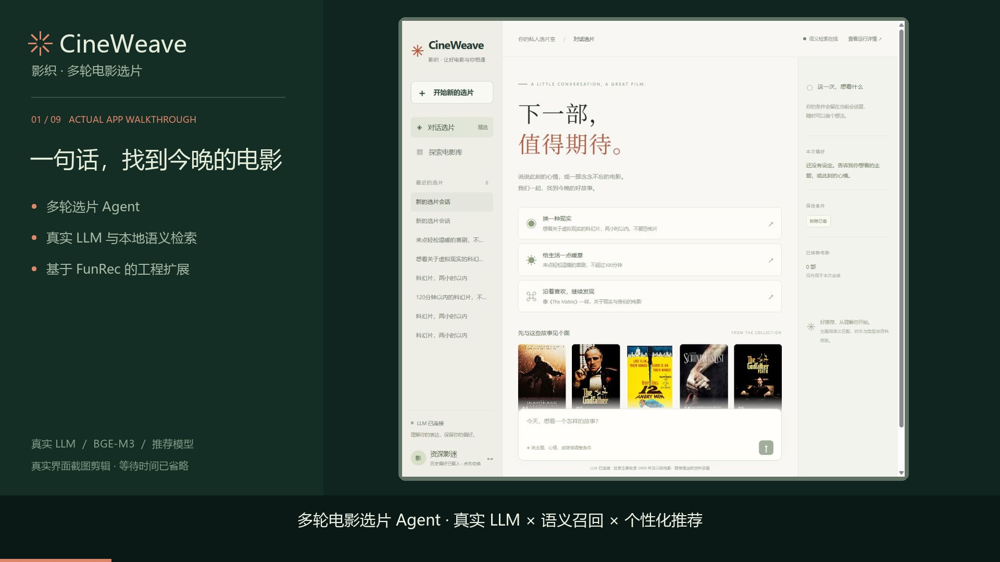

# CineWeave · 影织

**多轮电影选片：LLM 意图解析 × BGE-M3 语义召回 × 个性化推荐**

[](https://github.com/hershey1008/cineweave-agent/actions/workflows/unit-tests.yml)
[](LICENSE)
[演示视频](https://github.com/hershey1008/cineweave-agent/releases/tag/v0.1.0-demo)

用自然语言选片，继续修改条件、替换已看电影、查看推荐依据。支持多路召回、DeepFM 排序、会话条件更新、反馈和运行追踪。

[](https://github.com/hershey1008/cineweave-agent/releases/tag/v0.1.0-demo)

```text
Vue → FastAPI → LLM 结构化意图 → 会话与硬过滤
    → BGE-M3 / YouTubeDNN / I2I / 类型偏好 → 融合排序 → 事实解释
存储：PostgreSQL · Redis · Elasticsearch
```

## 快速开始：完整应用

需要 **Git、Python 3.11、Docker Engine / Docker Desktop 与 Compose v2**。镜像内安装后端依赖、构建前端；宿主机无需安装 TensorFlow 或 Node.js。

使用**真实 MovieLens-1M 的 FunRec 扩充数据和已有推荐模型**，不需要重新训练。数据包尚未公开分发，需要自己的可信本地快照；原始 1M 不含剧情简介、片长和海报。详见 [数据与模型](docs/DATA_AND_MODELS.md)。

### 1. 获取代码、配置环境

```bash
git clone https://github.com/hershey1008/cineweave-agent.git
cd cineweave-agent
python scripts/configure_local.py
```

生成 `.env` 和独立密码，不覆盖已有配置。真实 LLM 需要填写 `LLM_BASE_URL`、`LLM_MODEL`、`LLM_API_KEY`；留空进入明确标记的规则模式。

### 2. 加载数据、推荐模型与语义索引

先按 [打包方法](docs/DATA_AND_MODELS.md#制作本地数据包) 从已有快照生成本地包，再在新克隆目录安装：

```bash
python scripts/install_local_assets.py /path/to/cineweave-local-assets.zip
python scripts/pin_index.py
```

也可将 `.env` 路径直接指向已有 FunRec 数据和模型目录，见 [完整运行指南](docs/REPRODUCE.md)。

### 3. 准备语义编码器、构建镜像

```bash
python -m pip install requests
python scripts/download_embedding_model.py
docker compose build backend semantic frontend
```

BGE-M3 首次从官方固定版本下载并校验，之后读取本地缓存。YouTubeDNN / DeepFM 直接加载已有产物；语义索引从本地包恢复。

### 4. 导入数据、启动前后端

```bash
docker compose up -d --wait postgres redis elasticsearch
docker compose run --rm --no-deps backend python -m scripts.seed_cineweave
docker compose run --rm --no-deps backend python -m scripts.seed_redis_profiles
docker compose run --rm --no-deps backend python -m scripts.index_movies_elasticsearch
docker compose up -d --wait semantic
docker compose up -d backend frontend
docker compose ps
```

前端 **http://localhost:13000**；API 文档 **http://localhost:18000/docs**。账号 `demo@cineweave.local`、`history@cineweave.local`，默认密码均为 `CineweaveDemo!2026`。

试试：“想看关于太空探索的科幻片，120分钟以内，不要恐怖片” → “轻松一点，其他要求不变” → “第三部看过了，换一部”。

停止并保留数据：`docker compose stop`。配置 API 后：`docker compose up -d --force-recreate --no-deps backend`。开发启动、验收与排错见 [完整运行指南](docs/REPRODUCE.md)。

## 目录与文档

```text
cineweave-agent/
├── backend/
│   ├── app/              API、鉴权、Agent、会话与数据库
│   ├── online/           过滤、召回、排序、多样性与冷启动
│   ├── offline/          特征、训练、模型部署与 Redis 导入
│   ├── scripts/          数据初始化、ES 索引与集成验收
│   ├── tests/            后端单元测试
│   └── vendor/funrec/    模型定义、特征、训练与评估组件
├── semantic_service/
│   ├── app/              BGE-M3 编码、索引加载与检索 API
│   ├── offline/          内容清洗、质量审计与索引构建
│   └── tests/            语义索引测试
├── frontend/             Vue / Vite 页面、状态、接口与 Nginx
├── evaluation/           对话用例、检索查询与评估脚本
├── scripts/              配置、数据打包/恢复、模型下载、启停与视频制作
├── docs/                 运行、架构、契约、验收、来源与演示
├── licenses/             完整许可文本
├── .github/workflows/    Python 测试与前端构建 CI
├── .env.example          本机配置模板
└── docker-compose.yaml   六项运行服务
```

| 文档 | 内容 |
| --- | --- |
| [完整运行指南](docs/REPRODUCE.md) | 环境、数据导入、模型准备、前后端启动、验收与排错 |
| [数据与模型](docs/DATA_AND_MODELS.md) | 本地快照、打包/恢复、模型格式和分发状态 |
| [实际项目结构与全部文档](docs/PROJECT_STRUCTURE.md) | 模块、关键文件、运行产物及完整文档索引 |
| [架构](docs/agent-v1/architecture.md) / [接口契约](docs/agent-v1/contracts.md) | 推荐链路、状态与 API |
| [本地演示](docs/RUN_LOCAL.md) / [验收记录](docs/LOCAL_VALIDATION.md) | 演示步骤与已有实测口径 |
| [数据来源](docs/provenance.md) / [第三方说明](THIRD_PARTY_NOTICES.md) | 数据字段、来源和许可 |

单元测试：`python -m pip install -r requirements-test.txt`，然后 `python -m pytest -q`。检索质量仍待人工标注评估，不报告未经验证的效果提升。

基于 [Datawhale FunRec](https://github.com/datawhalechina/fun-rec)，保留 [CC BY-NC-SA 4.0](LICENSE) 署名与许可。数据、海报和模型遵循各自条款；密钥、本地数据包和权重不进入 Git。
