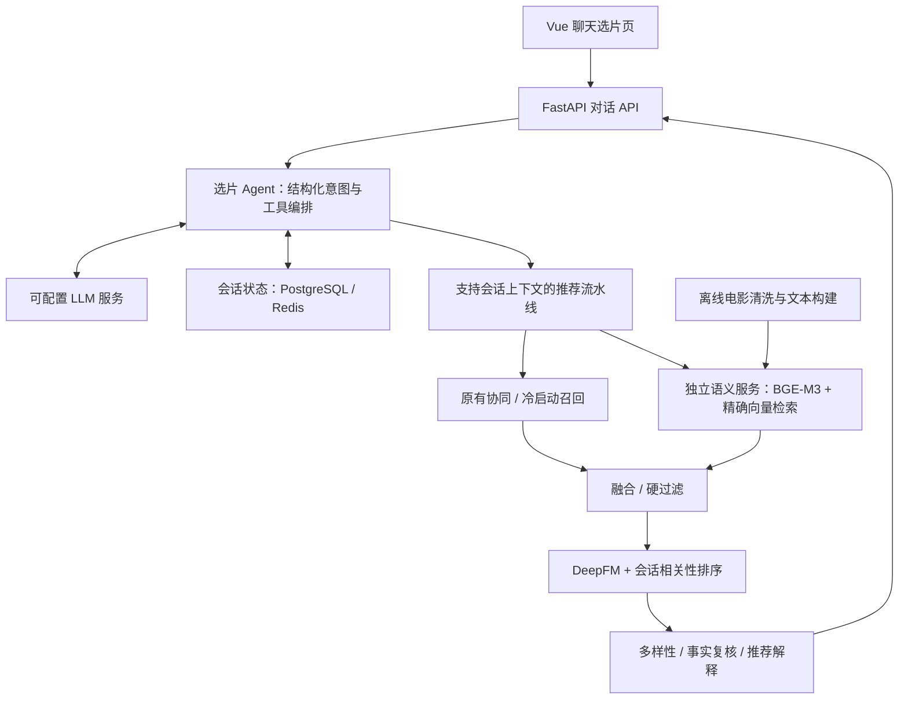

# CineWeave · 影织

**多轮选片 Agent × 语义召回 × 个性化推荐**

CineWeave 面向自然语言选片：理解用户本次需求，检索电影内容，结合长期偏好排序，并根据后续对话修改结果。项目基于 Datawhale FunRec 的电影推荐链路扩展。

> **当前包含 V1 应用代码、本地运行工具与验收测试。** 按本次开发约定，未配置 API 时使用明确标记的本地规则解析；语义检索使用真实 BGE-M3，个性化链路复用现有推荐模型。真实 LLM 接入和人工相关性评估需要分别完成，设计指标不等于已取得的结果。

## 本地支持的交互

> 用户：推荐几部关于虚拟现实的科幻片，两个小时以内，不要恐怖片。
>
> 用户：这些太严肃了，轻松一点。
>
> 用户：第三部看过了，换一部，其他条件保留。

系统维护会话条件，复用已有协同推荐能力，新增电影内容语义召回与会话排序。电影 ID、片长、年份等事实由业务数据确定。

## V1 架构



原五服务（前端、后端、PostgreSQL、Redis、Elasticsearch）增加一个语义服务。V1 使用已有电影简介构建向量，不涉及 Semantic ID 生成式召回或推荐模型在线训练。

## 文档导航

| 文档 | 内容 |
| --- | --- |
| [V1 技术架构](docs/agent-v1/architecture.md) | 范围、组件、离线索引、Agent、候选与排序、故障路径 |
| [接口与状态契约](docs/agent-v1/contracts.md) | API、会话修改、候选字段、存储、追踪 |
| [目录与改动清单](docs/agent-v1/project-structure.md) | 代码目录；相对 FunRec 的新增、修改、复用模块 |
| [评估与验收](docs/agent-v1/acceptance.md) | 数据、检索、对话、消融、回归、故障、性能标准 |
| [实施里程碑](docs/agent-v1/implementation-plan.md) | 阶段顺序、交付物、完成条件 |
| [来源与数据说明](docs/provenance.md) | 上游项目、数据边界、已检查情况、引用与后续许可要求 |
| [本地运行与演示](docs/RUN_LOCAL.md) | 启停、演示账号、模型/数据准备、LLM 配置与测试入口 |
| [本地验收记录](docs/LOCAL_VALIDATION.md) | 实际测试、功能范围和仍待验证的内容 |

## 仓库布局

```text
cineweave-agent/
├── backend/             # FastAPI / Agent / 推荐业务与测试
├── semantic_service/    # 独立嵌入服务与离线索引构建
├── frontend/            # Vue 对话、选片与浏览界面
├── evaluation/          # 查询草案、会话测试、评估运行器
├── scripts/             # 本地启动、模型下载与初始化
└── docs/                # 技术设计、运行说明与验收记录
```

本地页面：`http://localhost:13000`。在已准备好的项目目录执行 `./scripts/start.ps1` 启动，执行 `./scripts/stop.ps1` 停止并保留数据。首次环境准备和测试命令见运行文档。

数据审计中，将外部类型不是 `movie` 的 351 条关联保守隔离，语义目录使用其余 3532 条；原始 3883 条记录保留。类型过滤不等于完整的实体匹配人工审计。

## 开发约定

- 固定模型、索引、模板和实验配置版本；指标附带数据与协议。
- 用户身份由后端登录态确定；会话状态按用户与会话隔离。
- 当前请求的意图与权重通过参数传递，避免修改共享单例状态。
- 硬条件由结构化字段执行；LLM 不创造电影 ID 或补全未知事实。
- 凭据、`.env`、原始数据、模型权重、向量产物和用户日志不提交 Git。
- 后续引入上游源码时保留原许可、版权和来源说明。

设计基线：2026-10-19；本地实现：2026-10-20。初始 GitHub 提交为设计文档，本次应用实现按用户要求保存在本地。
