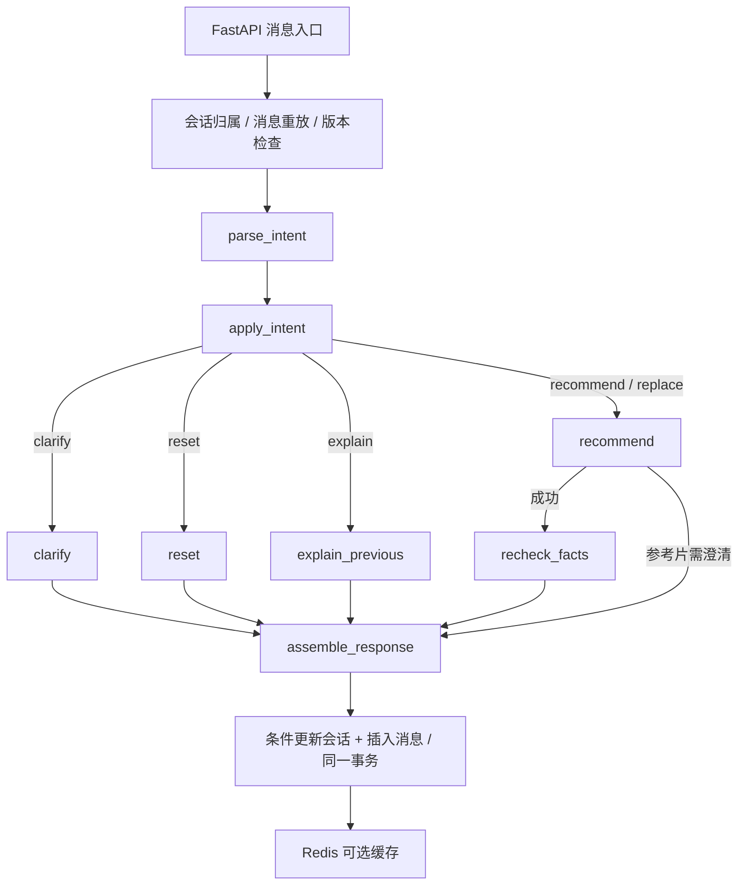

# 单轮 LangGraph 编排与对照验证

实现日期：2026-10-22。范围为单轮对话编排；推荐算法、HTTP 路径、请求字段和业务响应字段沿用原实现。

## 执行边界



- `orchestrator.py` 保留认证归属、重复消息检查、`expected_state_version`、数据库条件更新及提交、Redis 缓存。
- `workflow.py` 定义八个节点和条件路由；编译后的图可复用，每次请求的状态和运行上下文独立。
- `recommend` 复用 `recommend_context`，包含原有语义召回、协同召回、冷启动、融合和排序。
- `recheck_facts` 在模型及网络工作结束后重新读取电影事实，再检查硬条件并生成解释。
- `turn_runtime.py` 通过请求级 context 传入数据库会话、认证用户、请求和 LLM 客户端。这些依赖不进入图状态。
- `SessionState` 和 `IntentPatch` 继续负责业务状态与修改契约；长期画像仍来自现有数据库、Redis。
- 不启用 checkpointer、自动工具循环、节点重试或额外 LLM 调用。失败不会隐式切换到其他编排方式或规则解析。

图状态只用于本轮执行。跨轮业务状态仍以 PostgreSQL 为准，避免 checkpoint 与业务表成为两个状态来源。需要未来引入暂停恢复时，再单独设计幂等和持久化边界。

## 显式切换与回退

默认 `AGENT_ORCHESTRATOR=langgraph`。`legacy_turn.py` 保存本次改造前的单轮逻辑作为对照，移出了认证和事务外壳，但保留原业务步骤。两种方式通过同一外壳提交状态。

在本机 `.env` 中设置后重建后端容器环境：

```dotenv
AGENT_ORCHESTRATOR=legacy
```

```bash
docker compose up -d --force-recreate --no-deps backend
```

恢复图编排时改回 `langgraph`。未知配置会报错，不静默回退。切换不要求修改会话表和召回接口。

响应原字段保留；`trace.orchestration` 新增 `backend` 和顺序节点耗时。前端“运行详情”显示这些信息。

## 可重复的对照方法

```powershell
python -m pip install -r requirements-test.txt
python -m pytest -q
$env:PYTHONPATH='backend;.'
python -m evaluation.runners.compare_orchestration --repeats 30
```

Linux/macOS 可使用 `PYTHONPATH=backend:. python -m evaluation.runners.compare_orchestration --repeats 30`。

对照使用相同结构化意图与确定性服务替身，每轮独立状态。比较所有业务响应和非耗时 trace 字段，仅排除 `*_ms` 和新增的 `orchestration` 元数据。它不通过对真实 LLM 发起两次请求来制造无法控制的输入差异。

场景涵盖推荐、替换第三部、保留条件、清除片长、澄清、重置、解释、参考片、缺失参考片、无结果、组件降级、事实变化与电影删除。另有异常、取消、并行状态隔离，以及事务外壳的归属、幂等、版本竞争和提交测试。

本机结果见 [机器可读对照报告](../evidence/orchestration-comparison.json)：

| 项目 | 原流程 | LangGraph |
| --- | --- | --- |
| 对照场景 | 13 | 13 |
| 每场景重复次数 | 30 | 30 |
| 业务响应差异 | 对照基线 | 390 组比较，0 项差异 |
| 解析器调用次数 / 轮 | 1 | 1 |
| 本地编排耗时 P50 | 0.191 ms | 2.117 ms |
| 本地编排耗时 P95 | 0.307 ms | 2.801 ms |

这些耗时没有真实网络、模型、数据库和检索开销，只衡量固定替身下的编排开销。结果说明图增加了少量执行成本，不代表端到端性能提高，也不证明推荐质量提高。

真实 LLM、语义与推荐服务的多轮功能另用 `evaluation/runners/verify_llm_conversation.py` 验证。单元对照与真实服务结果分别记录，不能互相替代。

## 前端和展示

对话页与电影库复用同一个 `Header.vue`，采用白底、蓝色主色、无衬线字体、灰色边框和统一导航。聊天会话列表、条件与事实侧栏保留。窄屏通过“新会话”和“运行详情”操作，不依赖桌面侧栏。

本次展示入口为 [实际界面截图](../media/README.md)，不重新制作视频。旧视频、字幕、制作脚本与旧截图作为历史产物保留，不用于证明改造后的界面。

框架 API 参考：[Graph API](https://docs.langchain.com/oss/python/langgraph/graph-api)、[Runtime context](https://docs.langchain.com/oss/python/langgraph/graph-api#runtime-context)。
