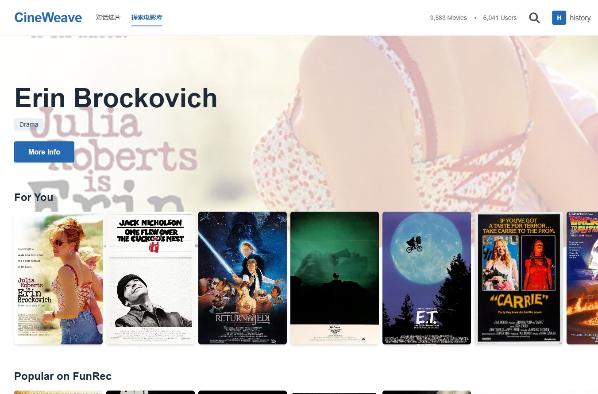
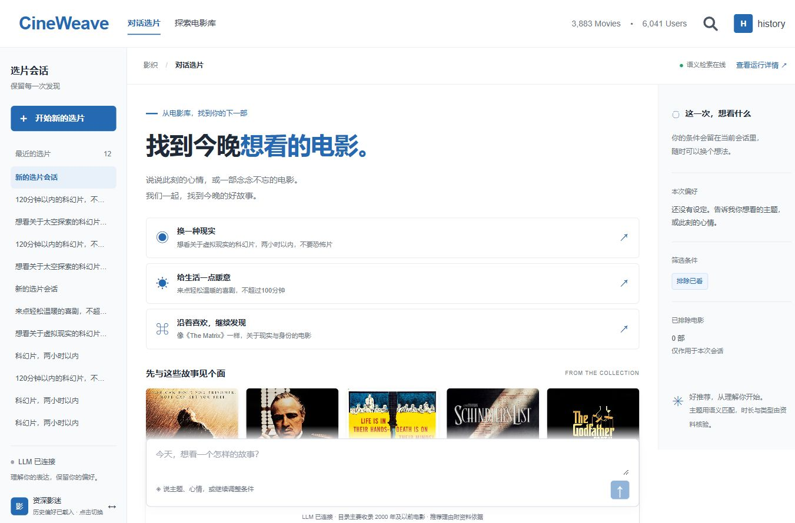
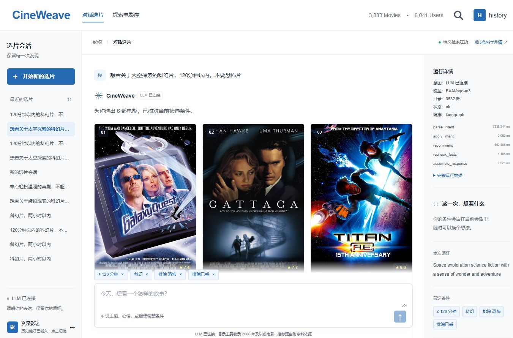
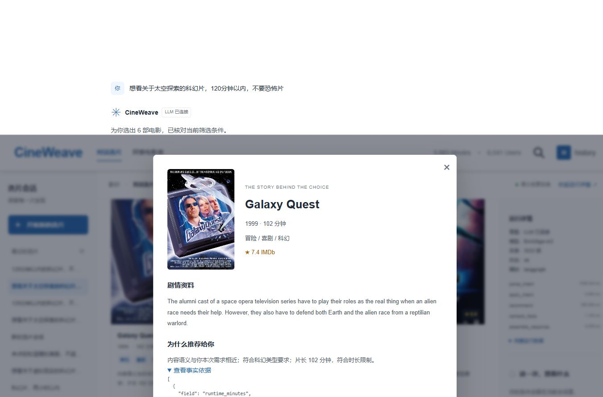
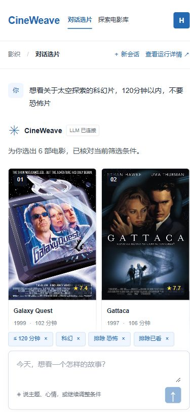
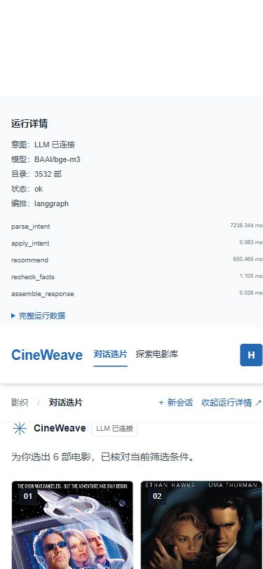

# 界面截图

2026-10-22：展示入口已改为实际应用截图，本次不重新录制或生成视频。对话选片与探索电影库共用导航、白底蓝色主题和无衬线字体。

以下截图来自本机运行的 Vue / FastAPI 应用。推荐请求实际使用已配置的 LLM、BGE-M3、协同召回和 DeepFM；运行详情显示 `langgraph` 及本轮经过的节点。电影与数值来自实际目录，未替换页面数据或拼接界面。

## 探索电影库

共用顶部品牌和主导航，保留电影海报浏览。

## 对话选片首页

蓝色主按钮、白色卡片和灰色边框与电影库保持一致；会话列表与条件侧栏保留。

## 选片结果与 LangGraph 运行详情

输入“想看关于太空探索的科幻片，120分钟以内，不要恐怖片”。右侧展示解析、修改条件、推荐、事实复核和响应组装节点；完整运行数据可按需展开。

## 电影详情与证据

电影资料、推荐理由和事实依据沿用后端返回内容。

## 移动端

以 390×844 CSS 像素验证：主导航、新会话入口、双列推荐卡片和输入框可用，页面没有横向溢出。“运行详情”在窄屏展开为顶部面板。

## 验证与边界

- 截图是单个页面时刻，不能用来推断响应延迟或推荐效果。
- [LangGraph 改造与对照](../agent-v1/langgraph-refactor.md) 记录固定输入的行为一致性和编排开销。
- [真实五轮回归](../evidence/langgraph-live-validation.json) 单独记录真实 LLM、条件保留、替换、清除片长和解释验证。
- 截图账号为本地演示身份，不包含密钥、令牌或私人账号信息。电影海报、简介保留第三方权利。
- 旧 `screenshots/01-*.png` 至 `08-*.png`、封面、视频分镜、字幕及制作脚本作为历史产物保留，不能用于证明本次界面。当前展示无需安装视频制作依赖。
